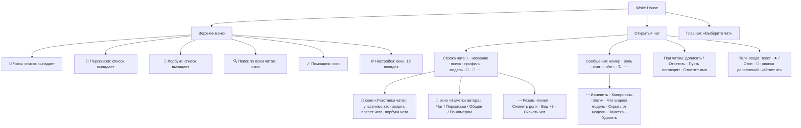
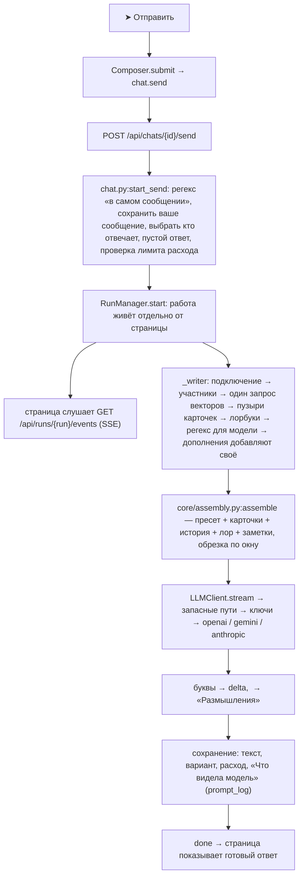

# Карта интерфейса: «нажал → получил → как это вышло» (2026-11-22)

Снято с кода (сборка `73f9f84`) и пройдено вживую в песочнице на **планшете 768×1024** (основное устройство
владельца) и мельком на телефоне 375×667. Интерфейс **не правился**: здесь только каталог и замечания.

Обозначения: ✓ — вживую так и есть; ✗ — вживую не так, как ожидаешь или как сказано в руководстве; ○ — вживую не
проверено (почему — сказано). `файл:функция` — где это сделано.

---

## 0. Общая карта экрана

---

## 1. Верхнее меню (планшет: первая строка)

| Нажал | Получил | Как вышло | Вживую |
|---|---|---|---|
| ˅ «Свернуть меню» | Первая строка исчезает, слева появляются ☰ · 🏠 · 🔍 · ⚙ | `main.js` `setMenuFolded(true)`, запоминается на устройстве | ✓ (по коду) |
| «White House» | Главная; чат остаётся в списке | `goHome` | ✓ |
| 💬 Чаты / 👥 Персонажи / 📖 Лорбуки | Список выпадает листом под значком; повторное нажатие закрывает | `setSheet(id)`, `Sidebar.js` | ✓ |
| 🔍 | Окно «Поиск по чатам»: «Обычные чаты / Разговоры с помощником», «По словам / Спросить нейронку», фильтры Персонаж, Группа, С–По | `Search.js` → `GET /api/search` или `/api/search/ask` | ✓ окно; сам поиск не запускал |
| 🪄 | Окно «Помощник»: «Чем помочь?», 4 готовых задачи (Создать персонажа, Создать лорбук, Объяснить ответ, Подобрать тему), поле, 📎 | `Assistant.js` → `api/assistant.py` → `services/assistant_engine.py` | ✓ окно; задачу не запускал (тратит модель) |
| 🪄 с меткой | Если помощник работает или ждёт — рядом «Работает» / «Ждёт вас», нажатие открывает нужную беседу | `openAssistantMark` | ○ (работы не было) |
| ⚙ | Окно настроек, вкладка «Основное» | `Settings.js` | ✓ |

## 2. Списки

### 2.1 Чаты

| Нажал | Получил | Как вышло | Вживую |
|---|---|---|---|
| «+» | Меню: Чат без персонажа · Импорт чата | `Sidebar.js` `MenuButton` | ✓ |
| Чат + «Чат без персонажа» | Новый пустой чат открыт | `POST /api/chats` (`character_id: null`) | ○ (не создавал мусор) |
| «Импорт чата» | Выбор файла `.jsonl` → чат в списке | `formats/jsonl.py` | ○ |
| Строка чата | Чат открывается | `onOpenChat` → `GET /api/chats/{id}/messages` | ✓ |
| ⋯ у чата | Переименовать · Скачать · В группу… · Удалить | `chatActions` | ✓ |
| «Показать пузырями» | Чаты становятся «пузырями» внутри рамок групп | `Groups.js` | ✓ (см. замечание 1) |
| «Открыть крупно» (в виде пузырей) | Окно «Группы» на весь экран | `Groups.js` | ✓ |
| «Группы» | Новая группа · Свернуть все | `Groups.js` → `api/groups.py` | ✓ |
| ⋯ у группы | Переименовать · Удалить группу | | ✓ |

### 2.2 Персонажи

| Нажал | Получил | Как вышло | Вживую |
|---|---|---|---|
| Имя персонажа | **Открывается его последний чат**; если чатов нет — новый | `Sidebar.js:openCharacter` (как в SillyTavern) | ✓ (подсказка у кнопки «— открыть последний чат» / «— начать чат») |
| ⋯ у персонажа | Последний чат · Новый чат · Карточка персонажа · Скачать (PNG) · В группу… · Удалить | `characterActions` | ✓ (пункта «Последний чат» нет, если чатов нет) |
| «+» | Пустая карточка | `CharacterEditor` с `null` | ○ |
| ⤒ «Импорт карточки» | Выбор PNG/JSON → персонаж в списке | `POST /api/characters/import/png` или `/characters` | ○ |
| «Карточка персонажа» | Окно с вкладками Карточка · Дерево · Регекс; ↶ отмена, 🕘 версии | `CharacterEditor.js`, `CharacterTree.js` | ✓ |
| Вкладка «Дерево» | Карта пузырей: Карта/Список, «+ Пузырь», «Векторизовать», «Шанс всем», масштаб | `TreeCanvas.js` (canvas) | ✓ |
| «Сохранить» в карточке | Сохраняет, плашка «Сохранено» | `PUT /api/characters/{id}` | ○ (не менял) |

### 2.3 Лорбуки

| Нажал | Получил | Как вышло | Вживую |
|---|---|---|---|
| «+» | Сразу новая книга «Новый лорбук» | `POST /api/lorebooks` | ○ |
| «⋯ Другие действия» | Один пункт: Импорт лорбука | | ✓ |
| Книга | Окно книги: Название, Описание, «Подключён: везде» (текст), Карта/Список, пузыри | `Lorebooks.js` + та же карта, что у персонажа | ✓ |
| ⋯ у книги | Скачать · В группу… · Удалить | | ✓ |
| Под названием книги | «везде» / «персонажей: 1» / «не подключён» | `lorebook-uses` | ✓ |

## 3. Строка открытого чата

| Нажал | Получил | Как вышло | Вживую |
|---|---|---|---|
| ‹ | Главная | `goHome` | ✓ |
| Название чата | Окно «Название чата» → переименовать | `askText` → `PUT /api/chats/{id}` | ✓ (по коду; на экране — подсказка) |
| Поле «Поиск» (только планшет) | Список найденных сообщений под чатом; найденное в другой ветке открывает ту ветку | `GET /api/chats/{id}/search` | ○ |
| Чип профиля («1 ˅») | Список профилей; выбор переписывает основное подключение, модель и пресет | `Profiles.js` → `services/profiles.py:apply` | ✓ список (в песочнице один профиль «1») |
| Чип модели («3.5-flash-lite») | Список моделей подключения + «Как в подключении» + «Другая модель…»; выбор — **только для этого чата** | `ModelChip.js` → `PUT /api/chats/{id}/meta` | ✓ |
| 👥 | Окно «Участники чата» (см. 6.1) | `Members.js` | ✓ |
| 📝 | Окно «Заметки автора» (см. 6.2) | `Notes.js` | ✓ |
| ⋯ | Режим чтения · Сменить роли · Вид: Пузыри · Вид: Документ · Вид: как в настройках · Скачать чат. На телефоне сверху ещё Поиск по чату, Участники и пресет, Заметки автора | `main.js:chatMenu` | ✓ |
| «Вид: Документ» | Сообщения без рамок, текст на всю ширину, только для этого чата | `PUT /api/chats/{id}/meta {chat_view}` | ✓ |
| «Режим чтения» | Пропадают шапка, кнопки под чатом и заголовки старых сообщений; сверху на ~3 с плашка «Режим чтения · Выйти»; поле ввода спрятано, у нижнего края полоска 44 px | `setReadingMode(true)` | ✓ (жесты пальцем не проверить мышью) |
| «Сменить роли» | Галочки у сообщений + строка: Номера «1-5, 8», роль, Применить / Всем сообщениям / Готово | `POST /api/chats/{id}/roles` | ○ |
| «Скачать чат» | Файл `.jsonl` | `GET /api/chats/{id}/export.jsonl` | ○ |
| «Регекс ждёт: N» (если есть) | Настройки → Регекс | | ○ (в песочнице нет) |
| Строка расхода | чат · сегодня · месяц | `Spending.js:SpendingBar`, включается в «Расход → Где показывать» | ✗ не видна (выключена в настройках) |

## 4. Сообщение

| Нажал | Получил | Как вышло | Вживую |
|---|---|---|---|
| Значок роли | Вы · Персонаж (сейчас) · Система → смена роли сообщения | `POST /api/chats/{id}/roles` | ✓ меню |
| ‹ / › | Листает варианты | `POST /api/messages/{id}/swipe` → `services/messages.py:select_swipe` | ✓ |
| › на последнем варианте последнего ответа | Новый вариант от модели | `onRegenerate` → `POST /chats/{id}/regenerate` → `chat.py:start_regenerate` | ✓, **но стрелок нет, пока вариант один** (замечание 4) |
| ↻ «Другой вариант» | Новый вариант, счётчик «2 / 2» | то же | ✓ |
| ⋯ → Изменить | Текст становится полем, «Сохранить / Отмена», Ctrl+Enter / Esc | `PUT /api/messages/{id}` | ✓ |
| ⋯ → Копировать | «Скопировано» | `core/clipboard.js` | ○ |
| ⋯ → Ветки | Панель под чатом: «Ветки: N», список, «Новая ветка отсюда» | `GET /api/messages/{id}/branches`, `POST /chats/{id}/branch` | ✓ панель |
| ⋯ → Что видела модель | Окно: пресет, модель, ≈ токенов, что не влезло из лорбуков, все части запроса | `GET /api/messages/{id}/prompt` → `storage/prompt_log.py` | ✓ |
| ⋯ → Скрыть от модели | Пометка «Скрыто от модели», на панели появляется кнопка «Вернуть модели» | `PUT /api/messages/{id}` (`exclude_from_prompt`) | ✓ туда и обратно |
| ⋯ → Написать заметку | Окно заметки к сообщению | `/chats/{id}/message-notes` | ○ |
| ⋯ → Удалить | Вопрос «Удалить это сообщение безвозвратно? Последующие реплики останутся» + «Больше не спрашивать» | `DELETE /api/messages/{id}` → `messages.py:delete` (удаляется одно сообщение со всеми вариантами) | ✓ вопрос (отменил) |
| «Размышления» | Сворачивается / разворачивается ход мыслей | `
` | ✓ |

## 5. Под чатом и поле ввода

| Нажал | Получил | Как вышло | Вживую |
|---|---|---|---|
| «Дописать» (последнее — ответ модели) | Модель продолжает **тот же** ответ с места обрыва | `POST /chats/{id}/continue-message` → `chat.py:start_continue_message` | ✓ (текст добавился в то же сообщение) |
| «Ответить» (последнее — ваше) | Модель отвечает | `POST /chats/{id}/continue` → `start_continue` | ○ |
| «Ответит: имя» | Отвечает именно этот персонаж | `continue` с `speaker` | ○ |
| «Пусть поговорят» (2+ персонажа) | Персонажи пишут друг другу до предела | `POST /chats/{id}/talk` → `start_talk` | ○ (в песочнице один персонаж) |
| ➤ Отправить | Ваше сообщение + ответ модели по буквам | см. раздел 7 | ✓ |
| Enter | На планшете / телефоне — новая строка; с мышью — отправка | `Composer.js:onKeyDown` (`pointer: coarse`) | ○ (мышь) |
| Стоп (во время ответа) | Ответ обрывается, написанное сохраняется | `POST /chats/{id}/stop` | ○ (поддельная модель отвечает мгновенно) |
| 📎 | До 8 картинок к сообщению; можно вставить из буфера | `POST /api/assets` | ○ |
| «Ответ от: Персонаж / Вы / Система» | От чьего имени модель напишет следующее; «Вы» = модель пишет за вас | `role` → `start_continue(role)` / `start_impersonate` | ✓ список |

## 6. Окна

### 6.1 Участники чата (👥)
Внутри по порядку: карточки участников (Заменить, ✎, ✕; «это я», Разговорчивость, «молчит», «Коротко о нём»,
Глубина, Важность) → «Добавить / Создать персонажа» → **Кто говорит** (кто отвечает; что модель знает об остальных;
ответов подряд) → **Пресет промпта этого чата** → **Лорбуки этого чата** → **Очерёдность лора**.
Запросы: `/api/chats/{id}/members…`, `/chats/{id}/speakers`, `/lorebook-uses`, `/chats/{id}/lore-order`. ✓ открыто.

### 6.2 Заметки автора (📝)
Вкладки Чат · Персонажи · Общие · По номерам; «показать все скрытые заметки», «Удалить все скрытые»,
«Добавить заметку». `api/notes.py`. ✓ открыто.

### 6.3 Настройки (⚙) — что на какой вкладке (вживую)
| Вкладка | Разделы |
|---|---|
| Основное | Интерфейс (меню, кнопки сообщения, плотность, размер текста, режим чтения, размышления) · Цветной текст · Заметки возле сообщения · Персонажи и вы · Удаление и подтверждения · Обновление программы |
| Подключения | Подключения к моделям · Профили · Несколько запросов сразу |
| Расход | Где показывать · Валюта · Лимит · Свои цены · За последний месяц |
| Промпт | Пресеты · Правка пресета · Блоки · Регекс пресета · Служебные строки · Поиск пузырей персонажей · Общие заметки автора |
| Лорбуки | Включены везде · Общие лорбуки · Сколько места · Как ищутся · Порядок · Тонкая настройка как в ST |
| Оформление | Цвета · Вид чата · Темы · Тема персонажа |
| Регекс | Общие правила |
| Картинки | Генерация · Подключение для картинок · Библиотека |
| Дополнения | Установить из файла / по ссылке; 🎲 Кубики, 🧠 Память++, ✎ Орфография, 🌳 Дерево мыслей, 🌐 Перевод — **все выключены** |
| Инструкции | навыки помощника |
| Изменения | журнал: Все / Сегодня / Неделя |
| Копии | список по дням · Настройки копий · Google Диск · Проверка данных |

### 6.4 Главная
Без чата: «Выберите чат» + «Новый чат» и «Новый персонаж» (на телефоне — «Список чатов» и «Персонажи»).
Без подключения: «Подключите модель» → «Добавить подключение». Без всего: «Создать персонажа / Импорт карточки /
Чат без персонажа». ✓ (первый вариант).

---

## 7. Как получается ответ модели (нажал ➤)

Проверено вживую на поддельной модели: отправка ✓, «Другой вариант» ✓, ‹ › ✓, «Дописать» ✓, правка ✓,
«Скрыть от модели» ✓ туда-обратно, «Что видела модель» ✓.

---

## 8. Где руководство (docs/GUIDE.md) не совпадает с живым

1. GUIDE: «Нажатие на имя [персонажа] открывает список». Вживую: открывает **последний чат**; список — по «⋯».
2. GUIDE: «**Продолжить** под чатом» (дважды, в разделах «Чат» и «Под сообщениями»). Вживую кнопка называется
   «Дописать» / «Ответить», и «Под сообщениями» описывает её иначе («модель пишет следующее сообщение»).
3. GUIDE противоречит себе про Enter: «Enter на телефоне — новая строка» и ниже «Enter отправляет». Подсказка на
   кнопке «Отправить сообщение (Enter)» на планшете тоже неверна — там Enter переносит строку.
4. GUIDE: «Строка расхода» в шапке как постоянная часть. Вживую её нет, пока не включена в «Расход».
5. GUIDE: в «⋯» сообщения есть пункты дополнений (🌐 перевод, «Новая глава отсюда»), в поле — 🎲 и 🧠. Вживую их
   нет: все дополнения выключены по умолчанию, и руководство этого не говорит.
6. Настройки → Основное → «Другие подтверждения» называют вопрос «Удаление сообщения **(и всего после него)**»
   (`Dialogs.js:18`), а удаляется одно сообщение, остальные остаются (`services/messages.py:delete`, и сам вопрос
   говорит «Последующие реплики останутся»).

---

## 9. Замечания по понятности (без правок)

Порядок — от того, что сильнее всего «удивляет» (главная претензия владельца: «ткнул — ожидал одно, получил другое»).

1. **Чаты неразличимы.** Все чаты персонажа называются его именем («Сильванетта» ×4); отличает только дата. В виде
   «пузырями» даты нет, и имена обрезаны («Сильванет…») даже в окне «Открыть крупно», где места хватает.
2. **Стрелки вариантов появляются только со второго варианта.** У свежего ответа ‹ › нет, поэтому привычный по
   SillyTavern жест «→ на последнем = новый вариант» на первом ответе не работает; остаётся только ↻.
3. **«Удалить» у сообщения убирает все его варианты сразу**, а вопрос об этом молчит. В SillyTavern так удаляют
   текущий вариант. Отдельной команды «удалить этот вариант» в меню нет.
4. **Профиль и модель рядом, а действуют по-разному.** «1 ˅» без подписи — это профиль (глобальный: подключение,
   модель, пресет), а «3.5-flash-lite» — модель только этого чата. В чате на другом подключении («fake») чип
   профиля всё равно показывает «1». Непонятно, что из них сейчас главное.
5. **Три способа «создать / импортировать» в трёх соседних списках.** Чаты: «+» открывает меню. Персонажи: «+» и
   отдельный значок импорта. Лорбуки: «+» сразу создаёт книгу, а импорт спрятан в «⋯ Другие действия».
6. **Новый чат с персонажем не найти из списка «Чаты».** Там только «Чат без персонажа». На главной планшета
   крупная кнопка «Новый чат» тоже создаёт чат **без** персонажа, хотя ждёшь выбора персонажа.
7. **Лорбуки чата спрятаны в «Участниках».** Кнопка называется «Участники чата и пресет», а внутри ещё «Кто говорит»,
   «Лорбуки этого чата» и «Очерёдность лора». Где книга подключена, в окне самой книги видно только текстом
   («Подключён: везде») — нажать нельзя; менять это нужно в трёх других местах (Настройки → Лорбуки; Участники;
   карточка персонажа).
8. **Три разных способа сохранять.** Карточка — кнопка «Сохранить» и плашка состояния; книга — «сохраняется при
   выходе из поля»; настройки — сразу. Неясно, надо ли что-то нажимать.
9. **Внешний вид разнесён на две вкладки.** Плотность, размер текста, цветной текст, кнопки сообщения, размышления —
   в «Основном»; вид чата, темы, цвета — в «Оформлении». Вид чата ещё и в «⋯» чата тремя пунктами (Пузыри /
   Документ / как в настройках) вместо одного переключателя.
10. **Две лупы с разным смыслом рядом.** 🔍 в меню ищет по всем чатам, поле «Поиск» в строке чата — по этому чату.
11. **Окно «Участники» многословно.** Под каждым полем постоянный абзац пояснений: на планшете одна карточка
    участника занимает пол-экрана. Это против «плотно, как в SillyTavern».
12. **Заметки автора «Общие» — в двух местах:** окно 📝 → «Общие» и Настройки → Промпт → «Общие заметки автора».
13. **«Кто напишет следующим» — три разных управления:** «Ответ от: Персонаж / Вы / Система» у поля, «Ответит: имя»
    под чатом и «Дописать / Ответить». Что «Ответ от: Вы» значит «модель пишет за меня», не сказано.
14. **Ветки.** У сообщения без развилки панель пишет «Ветки: 1» и показывает текущую ветку как чужую; «Новая ветка
    отсюда» открывается внизу под чатом, далеко от сообщения, по которому нажали.
15. **Режим чтения.** Через ~3 секунды плашка «Выйти» исчезает, и выход — невидимая зона 44 px у верхнего края. Так
    задумано, но без подсказки новичку не догадаться (есть ещё пункт в «⋯» последнего сообщения).
16. **Дополнения выключены все**, и в самом чате нет намёка, что «Память++», перевод, кубики существуют (подсказка
    есть только у орфографии).
17. **Карта пузырей открывается с середины** (пузырь №61), а не с начала или с корня.
18. **Телефон: порядок в строке чата** — модель · ⋯ · профиль: меню «⋯» стоит между чипами, а не в конце.
19. **На главной планшета «White House» написано дважды** (меню и строка под ним).
20. Мелочь для чтения с экрана: у книг кнопка «Действия с лорбуком» без названия книги (у чатов и персонажей
    название есть).

## 9а. Решения владельца по замечаниям (2026-11-22)

Принцип, который владелец задал при разборе: **не «как починить», а «как человеку удобно»**. Решение должно
идти от пути пользователя, а не от того, как сейчас устроен код.

| № | Решено |
|---|---|
| 1 | Под названием чата серая строка: дата · число сообщений · начало последнего сообщения (как превью в ST). Так и в списке, и в пузырях. |
| 2 | У последнего ответа стрелки ‹ 1/1 › есть всегда, → на последнем варианте просит новый. У старых сообщений с одним вариантом стрелок нет. |
| 3 | Если вариантов больше одного, в «⋯» два пункта: «Удалить этот вариант» и «Удалить сообщение». Тексты вопроса и строки в настройках («и всего после него») исправить. |
| 4 | Чип профиля подписан («Профиль: 1»). Не показывается, если профиль один или у чата своё подключение. Чип модели остаётся. |
| 5–6 | **Одно правило для всех списков:** вверху кнопка со словом «+ Новый чат / персонаж / лорбук». Персонаж и лорбук: выбор «Заполнить самому / Загрузить файл / Попросить помощника». «+ Новый чат» → список «с кем» (поиск, аватары, «без персонажа», «загрузить файл чата»); тап по имени = чат открыт с первым сообщением. В «⋯» открытого чата: «Новый чат с <имя>», «Другие чаты с ней (N)». Главная вместо «Выберите чат» — «Недавние» (аватар · дата · число сообщений · начало последнего) и «+ Новый чат». |
| 7 | В окне книги «Подключён: …» нажимается → галочки: везде / этот чат / персонажи. Одно место для всего. |
| 8 | Сохраняется везде само. Карточка тоже сохраняет себя после паузы. Кнопки «Сохранить / Отмена» убрать, откат — через ↶ и версии. |
| 9 | «Основное» — как ведёт себя программа. «Оформление» — всё, что меняет вид чата, в порядке, в каком это видит глаз. В «⋯» чата одна строка «Вид: Пузыри» — переключатель. Совпало с общей настройкой → чат снова «как везде». |
| 10 | Одна лупа. Окно поиска: «Этот чат» (выбран сам, когда чат открыт) · «Все чаты» · «Помощник». Тап по найденному → окно закрывается, чат прокручен к сообщению. Поле «Поиск» из строки чата убрать. |
| 11–12 | 👥 → окно «Чат» с вкладками «Участники · Кто говорит · Пресет и лорбуки». Участник — одна строка, подробности раскрываются по ⌄, пояснения по «?». На вкладке лорбуков видно, какие книги уже работают (везде / у персонажа). «Общие заметки» — только в окне 📝, в «Промпте» вместо них ссылка. |
| 13 | «Ответ от ˅» у поля убрать: никакого запомненного режима. Под чатом одна строка тихих кнопок: Дописать · (аватар) имя для каждого · За меня · Рассказчик (+ «Пусть поговорят» при 2+). «Отправить» → всегда отвечает персонаж. |
| 14 | В «⋯» сообщения пункт «⎇ Начать ветку отсюда», внизу плашка «Новая ветка. Прежняя сохранена · Вернуться». Где развилка уже есть, в шапке метка «⎇ 2», по тапу список веток прямо у сообщения (текущая отмечена). Нет развилки — нет ни метки, ни списка. |
| 15 | В режиме чтения всегда видны две тонкие чёрточки (сверху и снизу). В первый раз на устройстве подсказка «Сверху вниз — выйти. Снизу вверх — написать». |
| 16 | Выключенные дополнения видны серыми пунктами там, где жили бы («🌐 Перевести», «🧠 Память чата», «🌳 Думать перед ответом», 🎲). Тап → короткое пояснение и «Включить» → сразу выполняется. В Настройки → Дополнения серые пункты ненужных можно скрыть. |
| 17 | Карта в первый раз открывается с корня и первых пузырей, дальше — там, где её оставили (у каждого персонажа и каждой книги своё место). |
| 18 | Телефон: «⋯» чата — последним в строке. |
| 19 | На главной не повторять «White House» во второй строке. |
| 20 | Кнопка «Действия с лорбуком <название>» — с названием книги. |
| — | После переделки переписать раздел 1 `GUIDE.md` и устранить расхождения из раздела 8. |

**Сделано 2026-11-22:** 5–6 (`web/components/NewChat.js`, списки, главная «Недавние», меню чата), 13 (строка под чатом,
«Ответ от» убран), 20, строки чатов с датой · числом сообщений · началом последнего (часть 1, кроме вида
пузырями), подсказка «Отправить» про Enter, `GUIDE.md` по этим местам. Остальное — по очереди.

## 10. Что вживую не проверено и почему

- Жесты пальцем (режим чтения, карта, свайпы) — мышью их не проверить, нужен планшет.
- «Стоп» — поддельная модель отвечает мгновенно.
- «Пусть поговорят», «Ответит» за другого — в песочнице один персонаж в чате.
- Работа помощника, поиск «Спросить нейронку», генерация картинок, «Векторизовать» — тратят настоящую модель.
- Дополнения — все выключены; включать не стал, чтобы не менять песочницу.
- Внутренности больших вкладок (редактор пресета, подключения, регекс, копии) — открыты, но не пройдены по каждому
  полю.
